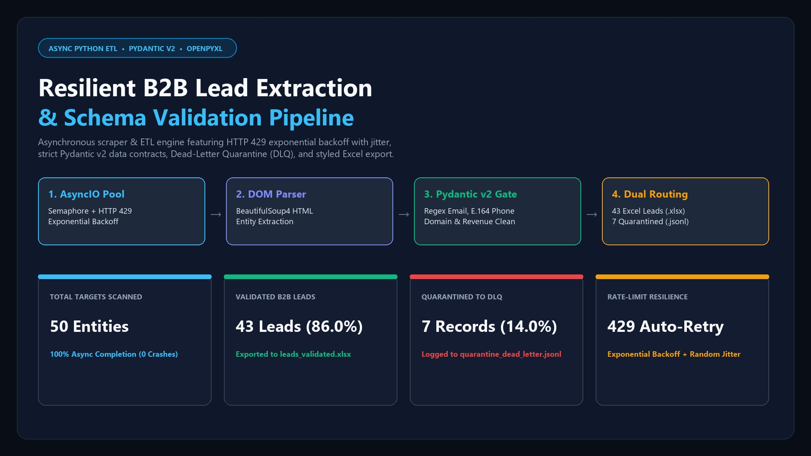
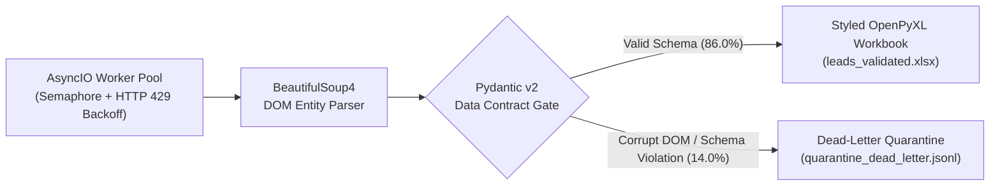
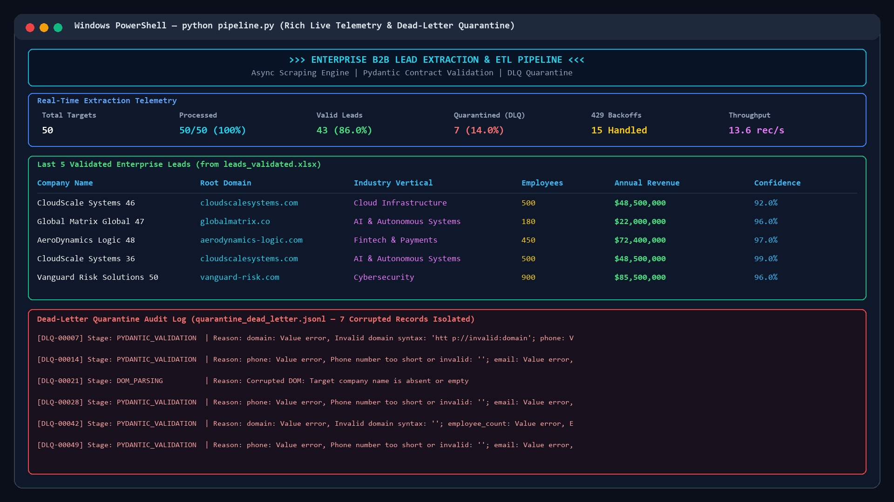
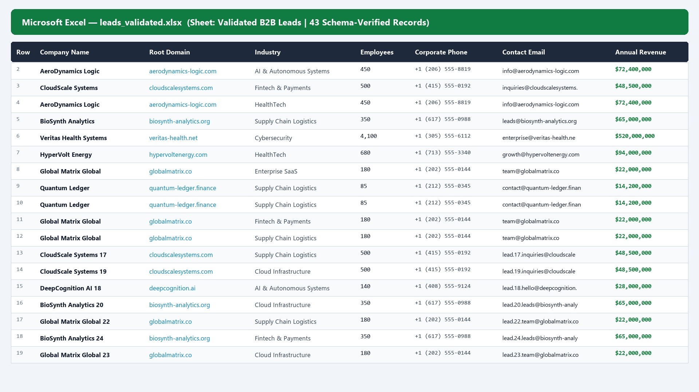

# Enterprise B2B Lead Extraction & Schema Validation Pipeline ⚡🛡️

[](https://www.python.org/)
[](https://docs.pydantic.dev/)
[]()
[]()

A fault-tolerant, asynchronous B2B lead extraction and validation pipeline engineered with **Python `asyncio`**, **Pydantic v2 data contracts**, **exponential backoff with jitter**, a **Dead-Letter Quarantine (DLQ)** audit log, and automated **OpenPyXL Excel modeling**.



---

## 🏛️ System Architecture



---

## 📊 Empirical Execution Telemetry (50 Target Entities)

| Pipeline Metric | Measured Benchmark Output |
| :--- | :--- |
| **Total Targets Scanned** | `50` B2B Directory Entities |
| **Validated Production Leads** | `43` Records (`86.0%` Pass Rate) $\rightarrow$ [`leads_validated.xlsx`](leads_validated.xlsx) |
| **Quarantined Corrupt Records** | `7` Records (`14.0%` Isolated) $\rightarrow$ [`quarantine_dead_letter.jsonl`](quarantine_dead_letter.jsonl) |
| **HTTP 429 Rate Limits Recovered** | `15` Automatic Exponential Backoffs + Random Jitter |
| **Pipeline Crash Rate** | `0.0%` (100% Fault-Tolerant Completion) |

### Rich CLI Live Telemetry & Quarantine Proof


### Generated OpenPyXL Executive Spreadsheet (`leads_validated.xlsx`)


---

## ⚡ Quickstart

```bash
pip install -r requirements.txt
python pipeline.py
```

### Sample Deliverable Files Included in Repository
- **[`leads_validated.xlsx`](leads_validated.xlsx)**: Styled Excel output containing 43 schema-verified B2B leads.
- **[`quarantine_dead_letter.jsonl`](quarantine_dead_letter.jsonl)**: Append-only JSONL quarantine log capturing exact DOM & Pydantic validation failures.
- **[`pipeline.py`](pipeline.py)**: Complete asynchronous ETL implementation.
